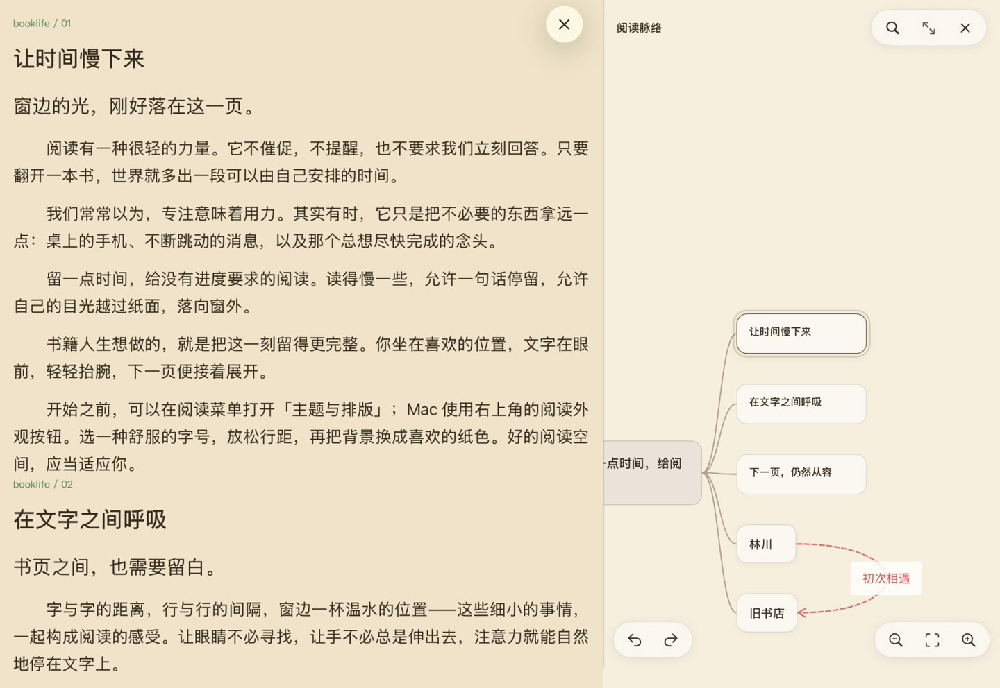

# 书籍人生 · booklife

在 iPad 上读 EPUB 和 PDF，在书页旁写笔记，再把人物、摘录和问题连成一张图。书库、笔记和手写保存在本机，离线阅读无需账号。

**[项目首页](https://123bigmirros.github.io/booklife/) · [观看 iPad 横屏演示](https://123bigmirros.github.io/booklife/#demo) · [从源码运行](#本地运行) · [阅读指南](docs/guides/reading.md)**

[](https://123bigmirros.github.io/booklife/#demo)

## 从书页到笔记

| 阅读时想做什么 | 在 booklife 里怎么做 |
| --- | --- |
| 留住一段原文 | 选中文字即可高亮、摘录或翻译。Apple Pencil 可以直接圈画，手写标记保留原页位置。 |
| 写下想法，理清关系 | 点开节点，在「笔记」「连接」「AI」之间切换。长按节点后点「添加」，新的子节点就接在它下面。 |
| 围绕选文继续问 | 发送前可查看上下文。AI 对话和翻译需要自行配置服务，回答会标明实际服务。 |
| 换个设备继续读 | iPhone、Mac 和终端也能阅读。可配置进度同步，Apple Watch 可通过蓝牙控制 iPad 或 Mac 翻页。 |

笔记、手写与书签目前保存在各自设备。局域网图书传输适用于可信网络。详见[安全与隐私](SECURITY.md)。

## 本地运行

**0.5.0 开发预览，目前提供源码构建。**

运行要求：macOS 13+、iOS/iPadOS 17+、watchOS 10+。编译需要完整 Xcode 26+、Python 3.10+；本轮本地验收使用 Xcode 26.6。JavaScript 检查另需 Node.js。

```sh
python3 scripts/generate_project.py
open booklife.xcodeproj
```

优先选择 `booklifePhone` scheme 和 iPad 模拟器运行（iPad/iPhone 共用这个 target）。模拟器无需个人签名；真机请在 Xcode 选择自己的 Team，并为 Phone、Watch 及配套标识配置一致的 Bundle ID。

Mac 开发版：

```sh
bash scripts/build-mac.sh
open "$HOME/Library/Caches/AppleProjectBuilds/book-slide/mac/Build/Products/Debug/booklife.app"
```

这使用本地 ad-hoc 签名，不是公证发行包。终端入口见 [终端阅读器](docs/guides/terminal.md)。

## 开发与贡献

Swift 代码在 `Apps/` 和 `Sources/`，iPad 交互测试在 `Tests/`。运行项目检查：

```sh
bash scripts/check.sh
python3 scripts/check-publication.py
```

[架构与验证](docs/development/architecture.md) · [贡献指南](CONTRIBUTING.md) · [完整文档](docs/README.md)

项目自有代码与原创资源采用 [MIT 许可证](LICENSE)。离线阅读引擎、字体与结构图库的来源及许可证见[第三方声明](THIRD_PARTY_NOTICES.md)。
