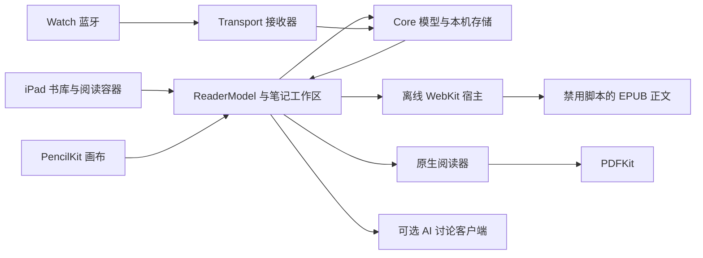

# 架构与验证

## 当前边界

| 位置 | 责任 | 主要边界 |
| --- | --- | --- |
| `Sources/BookSlideCore/` | 协议、签名、配对、会话、进度、书库索引、笔记与关系模型 | 不依赖 SwiftUI/WebKit；部分存储依赖 Apple 系统服务 |
| `Sources/BookSlideTransport/` | Network.framework HTTP、蓝牙接收、终端转发 | 输入验证交给 Core 路由，处理在主队列运行 |
| `Sources/BookSlideTerminal/` | EPUB / PDF 文本提取、终端排版与目录 | 依赖 Core；使用受限的 zip/unzip 子进程 |
| `Sources/BookSlideCLI/` | 终端交互与进程入口 | 组合 Terminal、Transport、Core |
| `Sources/BookSlideMac/App/` | Mac 入口、窗口管理与设备协调 | Mac 平台外壳 |
| `Sources/BookSlideMac/Reader/`、`Notes/`、`Sync/` | ReaderModel、跨平台阅读/笔记组件与进度同步 | Mac 与 iPad/iPhone 共用，尚未提取为独立 SwiftPM 模块 |
| `Sources/BookSlideMac/Resources/Reader/` | 离线 WebKit 脚本、字体与原创示例 | Mac/iOS 共享资源，第三方许可证与资源同目录保留 |
| `Apps/iOS/` | iPad/iPhone 书库、阅读容器、触摸与 PencilKit、Mac 书库连接 | 按 App、Library、Reader、Connectivity 分组，共用 `booklifePhone` target |
| `Apps/watchOS/`、`Apps/Shared/` | Watch 控制、蓝牙发送、兼容中继与 App Intents | 直接连接优先，保留兼容路径 |



书库、传输和进度共用图书模型。`BookFormat` 负责格式识别和导入类型，`BookImportFile` 校验内容。现有 EPUB 条目由文件名识别，旧 Mac 书目没有格式字段时按 EPUB 读取。阅读器提供目录、搜索结果和稳定的正文位置，`ReaderModel` 用同一套方式保存进度、书签和笔记。EPUB 沿用 WebKit 和 CFI，PDF 通过 PDFKit 显示原页，以页地址作为图形界面和终端的共同锚点。增加格式时登记其类型和校验，实现相应的阅读适配，书库和笔记结构可以继续复用。

PDF 原版和文字重排用相同的 PDF 页地址与文字范围。选文事件进入共用的笔记命令，图模型和导出读取同一个原文地址。原版手写用 PDFKit 页叠层显示，笔迹坐标取未缩放的裁切框，保存在同一套笔记资源与草稿存储。扫描识别生成本机派生副本，索引、传输和进度继续用原文件的内容指纹。

阅读位置由正文引擎维护。手指、触控板与滚动条输入统一清除旧重排锚点，宿主与 EPUB iframe 使用同一条输入链路。笔记关闭使用非用户导航的 `restoreReadingPosition`；若目标文字已处于正确位置，不再执行 `display()`。iPad 点按正文只切换工具，分页模式要求明确的水平轻扫，避免隐藏页边热区和竖向选字动作触发翻页。

正文、笔记和手写以 CFI、章节/文本锚点和布局标识关联。索引保存保留上一份可读备份；手写资源使用不可变版本，先写资源再更新索引。失败时保留草稿，删除笔记支持恢复。不要将读写失败解释成空书库后覆盖原数据。

## 统一阅读图

`ReadingGraph` 是每本书唯一持久化的内容模型，存储版本为 `1`。`ReadingNodeID` 以类型、所属记录和局部标识区分笔记、人物/概念、手写、AI 讨论、消息和原文快照；消息标识属于所在讨论，跨书或导入相同消息不会碰撞。`ReadingEdge` 保存方向与语义，包括提及、摘录、讨论、消息归属、回应、引用、人物关系和用户自定义关联。人物关系和笔记引用共用节点及边，类型只决定编辑控件与展示方式。

讨论内容拆为讨论节点、消息节点和引用快照，通过边恢复消息顺序与当时依据。`ReaderAnnotation` 等旧接口是内存中的派生适配器，供 EPUB、手写编辑器和导出继续使用；磁盘上只写 `graph`，不再同时维护几套数组。EPUB 的脚本桥只接收正文标记需要的内容，不传送完整对话。`BookNotesIndex` 负责章节布局、阅读进度过滤和检索投影，视图不直接改索引文件。

选文讨论通过独立的 `ReaderSelectionDiscussion` 展示，不经过笔记工作区；`ReaderModel.selectionDiscussion` 只负责当前面板的临时状态。它与笔记内讨论复用 `ReaderDiscussionPanel` 的流式请求、引用与保存能力。选段仅打开再关闭时不生成记录；输入问题后进入统一阅读图，同一 CFI 的重新选取会恢复原对话或本机草稿，已有数据格式不变。

iPad 并排视图的呈现由 `PhoneReadingView` 单独协调：WebKit 一次切到最终尺寸，`ReaderPencilHost` 在正文上方、旁栏下方的透明表面临时保留纸面快照。纸面的裁剪边缘和旁栏以同一曲线移动，字形只平移而不缩放；等移动结束且 `reader.settledPosition()` 完成锚点恢复后，短暂淡出快照。关闭时先在不透明纸面后恢复阅读检查点，再交还正文；仅高度变化直接交接，换行变化经过纸色交接，避免两套字形叠影。纸面和旁栏共用 0.42 秒的零起步速度曲线；中途反向复用正在呈现的纸面和位置。透明表面始终不参与命中测试，过渡取消或超时会移除快照并恢复正文交互。键盘避让只压缩旁栏，横屏正文保持原视口。新笔记等纸面与旁栏都就绪后再获得输入焦点，结构图折叠时保留原视口和缩放；这些呈现状态不写入阅读图。动画遵循减少动态效果设置，旧的过渡任务在取消或切书时失效。

主要节点的手动连线统一使用 `ReadingNodeLinks`：起点和终点都是 `ReadingNodeID`，人物、笔记、AI 对话与手写无需选择不同的创建流程。搜索结果只改变本地连接草稿；确认后由 `ReaderModel.connectReadingNodes` 校验并提交命名边，重复的同向同名连接会复用。提交完成回到图并选中新边，既有关系边与早期未完成草稿仍保留读取和恢复路径。独立 AI 回复过程中暂不开放连接，避免切到图时中断生成。

`ReaderModel.commitReadingGraph` 是共同的提交边界：先在副本上应用修改、校验并原子写入，再发布可见状态和刷新正文标记。人物、笔记与讨论沿用自动保存；节点之间的关联使用同一连接控件。失败的文字/讨论输入保存在 `NoteDrafts/`，人物编辑使用同样的节点封套写入 `NodeDrafts/`；这些本机内容均被 `.gitignore` 排除。删除保留节点墓碑，恢复不删除其他人物，编辑父笔记也保留被移除讨论的恢复数据。

选文菜单的「添加节点」也进入这一提交边界：用户从选文中确认名称，并选择人物、地点、概念等类型，`ReadingGraph.recordEntity` 一次性保存节点与带原文位置的记录，复用同类型中已有名称或别名对应的节点，并保留已有笔记和对话。后续连接笔记、人物或 AI 对话仍使用 `ReadingNodeLinks`；连接结果标明节点类型，没有独立的人物数据库。

仅为节点保存出处、没有想法、标题、疑问或讨论的原文记录，由 `BookNotesIndex` 投影为 `entitySourceOnly`：图上只展示事物节点，并从所属章节直接连接，原文仍可在节点详情中查看和补写笔记。已有来源记录同样适用，不删除或改写其标识、原文与关联。用户写入内容或显式建立连接、关系依据后，记录作为独立节点展示，避免把添加人物误变成同时添加同名「想法」。

编辑界面通过 `ReadingInterface.swift` 共用标题栏、工具按钮、输入框、原文卡片、端点卡片和创建页操作区。iPad 的 `PhoneReadingView` 始终使用同一个 `BookNotesWorkspace` 承载笔记、独立选文 AI、选文节点与节点/连接创建；传入关闭过渡期间的选文快照，避免内容闪回。组件通过 `connect` 回调进入同栏创建，`creationReturn` 保留取消时的返回位置；确认后使用统一选择定位结果。独立 AI 仍复用自身的对话运行与保存逻辑，没有把对话内容合并成节点表单。非阅读伴随模式保留浮层创建，`creationResult` 在 `onDismiss` 后且原图书仍处于当前状态时更新选择。选文创建节点与手动创建节点共用视觉组件，选文节点保留原文出处，允许使用原文之外的自定义名称；空名称和超过 80 字的名称会在添加按钮旁说明原因。手动创建允许稍后补充出处。

读取旧书库时自动把原来的笔记、人物、关系、手写与讨论转成图，保留原标识、引用、未发送问题和恢复记录。首次保存保留原索引为上一份可读备份。迁移后的索引需要支持阅读图的新版本，旧版应用不能直接读取；备份是滚动的一份快照，不能作为长期降级方案。遇到未知的更高图版本会阻止编辑，不会用旧备份静默覆盖新数据。

iPad 图谱使用按视口裁剪的 CAShapeLayer 连接线，由主线程维护图层；不为整张大书图谱分配位图，也不通过 UIView 在后台分块绘制。图默认占主要空间，键盘输入和长讨论时可收起结构图；关联搜索使用适应键盘高度的系统面板。

文本选择由 WebKit 保持连续的原生选区。iPad 手指拖动时只发布选区是否存在，菜单按需请求 CFI、摘录和章节进度；相同范围复用已解析的信息。Pencil 使用原位范围更新与缓存的字素分段，同一字上的重复样本不重置选区。高亮按 CFI、类型、颜色和主题增量刷新，修改笔记文字不重建已有 SVG 图层。原生菜单的每次呈现使用独立标识，关闭回调只能清理它所属的选区；如果下一次拖选已经开始，不再清空新范围或弹回旧菜单。

WebKit 宿主只加载随包脚本，通过有限消息与 ReaderModel 交互；正文 iframe 不执行图书自带脚本。远程控制需匹配当前阅读会话并验证签名，避免切书/恢复连接后执行旧指令。AI Key 与配对 token 保存在 Keychain，书库及导出不包含密钥。

## 构建来源

booklife（书籍人生）沿用 BookSlide 的应用标识、钥匙串服务、书库路径和设备通信协议，已安装的版本可直接更新。源码模块保留原标识，Xcode 工程和共享 scheme 使用 booklife 名称。终端入口为 `./booklife`，旧命令 `./bookslide` 会转入同一程序。

`Package.swift` 定义 macOS SwiftPM 的 Core、Transport、Terminal、CLI、Mac 与单元测试。`scripts/generate_project.py` 是 Xcode 工程、三个 Info.plist、共享 scheme 与 iPad 托管测试的来源。Phone target 直接编译部分 `Sources/BookSlideMac/` 与 Transport 源码；通过 `canImport` 兼容 SwiftPM 模块与 Xcode 单 target 构建。

新增共享文件时必须同步检查两条构建路径。共享脚本、字体和示例书位于 `Sources/BookSlideMac/Resources/Reader/`，由 Mac/Phone 共用，运行时无需 CDN。工程导航按磁盘目录分组，源码引用使用仓库相对路径。历史安装记录、试验工程和同步冲突副本归档在忽略的本地 `build/` 中，不能进入构建或源码发布包。

## 优先演进方向

1. **先保证 iPad**：以 11 英寸 iPad Pro 横屏为主，覆盖阅读、选字、Pencil、键盘、竖屏和分屏，确保切工具、切章节、关闭窗口都不丢草稿。
2. **提取共享阅读模块**：逐步将 ReaderModel、笔记 UI、资源移入明确的共享模块，Phone/Mac 只保留平台外壳。同步收敛 SwiftPM 与 Xcode 依赖声明，在数据兼容与 iPad 回归通过后逐步迁移。
3. **拆分 ReaderModel 职责**：优先抽出书库仓储、阅读引擎适配、笔记/讨论协调器。视图消费状态并发出意图，保持明确的主线程边界。
4. **扩展迁移覆盖**：阅读图已有显式版本与旧索引迁移夹具；后续模式变化继续提供版本化迁移，覆盖未知版本保护、旧数据升级与失败恢复。
5. **再扩大发行范围**：加密局域网传输、设备凭据撤销、发行签名与隐私清单应独立验收。单元测试不能证明真机蓝牙、Pencil Pro 手势或耗电合格。

## 验证命令

```sh
# Swift 与 Node 单元测试，Mac / Watch / Phone 无签名构建
bash scripts/check.sh

# iPad 实际 UIKit/WebKit/PencilKit 与 UI 测试，使用独立的临时书库。
# 由本机公共入口选择共享 iPad 并排队；不要新建项目专属设备。
# 退出时自动清理模拟器构建，保留测试报告；调试时可设置 BOOKSLIDE_KEEP_SIMULATOR_BUILDS=1。
bash scripts/check-simulator.sh

# 清理历史模拟器构建；省略 --apply 仅预览。
python3 scripts/clean-simulator-builds.py --apply

# 实际 WebKit 沙箱、锚点、选文与批注检查（逐项运行）
xcrun swift scripts/checks/reader-webkit-check.swift
xcrun swift scripts/checks/reader-progress-check.swift
xcrun swift scripts/checks/reader-structure-check.swift
xcrun swift scripts/checks/reader-annotations-check.swift

python3 scripts/check-publication.py
```

网络、文件协调、安全作用域书签与 WebKit 子进程测试需要正常 macOS 会话权限。受限沙箱中无法访问这些服务时应记录环境限制，不删除断言或把失败误报为通过。常规 AI 测试用本机协议桩，不访问付费模型；需要明确 opt-in 的集成测试默认跳过。

CI 使用 [GitHub 的 macOS 26 runner](https://github.com/actions/runner-images/blob/main/images/macos/macos-26-Readme.md)，固定 checkout 提交并禁用凭据持久化。CI 不签名、不发布、不访问个人设备或真实密钥。
